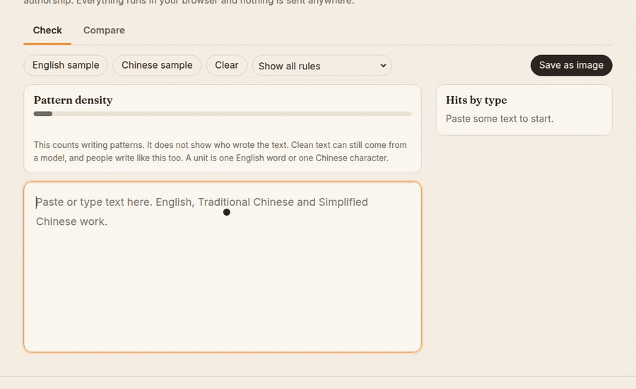

<div align="center">

# AiSniff

**貼上文字，看哪些句子讀起來像 AI 寫的。**

[English](README.md) · [繁體中文](README.zh-TW.md) · [简体中文](README.zh-CN.md) · [日本語](README.ja.md) · [한국어](README.ko.md) · [Español](README.es.md) · [Français](README.fr.md) · [Deutsch](README.de.md) · [Português (BR)](README.pt-BR.md)

[線上體驗](https://arthur031221.github.io/AiSniff/) · [文件](docs/usage.md) · [MIT](LICENSE)



</div>

AiSniff 會標出英文與中文文字裡，符合已公開記載的 AI 寫作模式的那幾個詞句。每個標記都寫明命中的規則、附上公開來源，並給出平實的改寫建議。同一組 JSON 規則可用於網頁編輯器、命令列和 agent skill，不需要伺服器，也不呼叫任何模型。

**它呈現的是模式，不是作者。** 沒有命中不代表是人寫的，有命中也不代表是模型寫的。

## 對文字做了什麼

| 修改前                                                                                                                                                       | 修改後                                                                                              |
| ------------------------------------------------------------------------------------------------------------------------------------------------------------ | --------------------------------------------------------------------------------------------------- |
| In today's fast-paced world, our update is a game-changer that unlocks your full potential. We are committed to excellence, and we are thrilled to share it. | Version 2.1 fixes the crash on startup when the config file is empty. Details are in the changelog. |
| **3 處**: `en.opener.todays-world`, `en.promo.commitment`                                                                                                    | **0 處**                                                                                            |
| 在當今快速發展的數位時代，溝通至關重要。                                                                                                                     | 這封信想請你在週五前確認報價。                                                                      |
| **2 處**: `zh-TW.opener.era-hat`, `zh-TW.significance.vocab`                                                                                                 | **0 處**                                                                                            |

命中數是對這幾句話執行 `aisniff lint` 的結果。右欄是依建議手動改寫的。

## 區分得有多準

在 HC3（公開的問答資料集，同時有人類與 聊天機器人 的回答）保留不用的測試半邊，英文規則在 **29% 的 聊天機器人 回答和 2% 的人類回答**中至少標出一處。中文是 **24% 對 6%**。

請連同限制一起讀。測試半邊有英文人類回答 23,752 筆、聊天機器人 13,422 筆，中文分別是 9,812 與 8,480 筆。聊天機器人 的回答來自它剛推出的幾個月，所以較新模型的詞彙規則無法在上面驗證。英文 聊天機器人 回答有 71% 完全沒有命中。密度的 AUROC 英文為 0.63、中文為 0.59，所以單靠密度只是很弱的偵測器。部分規則在這份資料上站不住腳，評估頁有列出。方法與逐規則的數字見 [docs/evaluation.md](docs/evaluation.md)，也可以用 `npm run eval` 重跑。

## 指令

```bash
npx github:Arthur031221/AiSniff lint draft.md
```

| 指令                                      | 作用                                                                                                                                                                                                                                   |
| ----------------------------------------- | -------------------------------------------------------------------------------------------------------------------------------------------------------------------------------------------------------------------------------------- |
| `aisniff lint [files...]`                 | 掃描檔案，沒有給檔案時讀標準輸入。逐項印出位置、信心、規則、說明與建議。                                                                                                                                                               |
| `aisniff lint --format json`              | 同樣的結果輸出成 JSON，含來源網址、各類型數量與密度。                                                                                                                                                                                  |
| `aisniff lint --format github`            | 每個命中輸出一則 GitHub Actions 註解。                                                                                                                                                                                                 |
| `aisniff lint --min-confidence medium`    | 隱藏弱訊號。可用值：`low`、`medium`、`high`。                                                                                                                                                                                          |
| `aisniff lint --max-density 20`           | 每千單位的命中數超過該數字時以代碼 1 結束。                                                                                                                                                                                            |
| `aisniff lint --max-weighted-density 8.7` | 加權密度（網頁儀表使用的刻度）超過該數字時以代碼 1 結束。                                                                                                                                                                              |
| `aisniff lint --disable en.promo`         | 略過一條規則，或某個前綴（例如 `en.promo`）下的所有規則。重複使用此旗標可略過更多。                                                                                                                                                    |
| `aisniff lint docs/`                      | 掃描資料夾與其子資料夾中的 `.md`、`.markdown`、`.mdx` 和 `.txt` 檔案。                                                                                                                                                                 |
| `aisniff lint --markdown off`             | 把 Markdown 檔案當作純文字掃描。預設會略過 `.md`、`.markdown` 和 `.mdx` 檔案中的程式碼區塊、行內程式碼、前置資料、註解和連結網址。可選值：`auto`、`on`、`off`。                                                                        |
| `.aisniff.json`                           | 為專案設定相同的選項：`format`、`minConfidence`、`maxDensity`、`maxWeightedDensity`、`disable`、`markdown`、`lang`、`locale`。從目前資料夾往上找，直到儲存庫根目錄。命令列旗標優先。`--config FILE` 指定檔案，`--no-config` 則忽略它。 |
| `aisniff lint --lang en`                  | 只載入一個規則包。可用值：`auto`、`en`、`zh-TW`。                                                                                                                                                                                      |
| `aisniff lint --locale zh-TW`             | 以繁體中文顯示說明與建議。                                                                                                                                                                                                             |
| `aisniff rules`                           | 列出全部 61 條規則與其信心。                                                                                                                                                                                                           |
| `aisniff explain <rule-id>`               | 顯示單一規則、通過與不通過的範例，以及來源。                                                                                                                                                                                           |

結束代碼：0 為掃描完成且未超過上限，1 為超過上限，2 為用法錯誤。文字輸出的最後一行會說明它衡量的是模式，不是作者。

## 編輯器

開啟[線上體驗](https://arthur031221.github.io/AiSniff/)，或執行 `npm install && npm run dev`。

- 滑過或點一下標記，看規則、改寫建議與來源。部分規則提供一鍵改寫，且保留復原功能。
- 側欄依類型分組。儀表顯示每千字或每千個字元的命中數，並註明它計算的是模式，不是作者。
- 對照頁籤放修改前與修改後的文字，並顯示命中數的變化。
- 可把標註後的文字存成 PNG。
- 可用按鈕或把檔案拖到編輯區，開啟 2 MB 以內的 `.txt`、`.md`、`.markdown` 或 `.mdx` 檔案。檔案只在瀏覽器內讀取。網頁版把 Markdown 當純文字掃描，要略過程式碼區塊請用 CLI。
- 九種介面語言：English、繁體中文、简体中文、日本語、한국어、Español、Français、Deutsch、Português (BR)。規則說明有英文與繁體中文。
- 輸入簡體中文時，會經由保留位置的逐字轉換，用繁體中文規則檢查。

## 安裝

<details>
<summary>網頁</summary>

使用[線上體驗](https://arthur031221.github.io/AiSniff/)。貼上的內容不會離開這個頁面。若要自己架站，執行 `npm run build:web` 後提供 `dist/web`。

</details>

<details>
<summary>命令列</summary>

需要 Node 22 或更新版本，CI 以 22 與 24 測試。

```bash
npx github:Arthur031221/AiSniff lint draft.md
```

或從原始碼：`npm install && npm run build:cli && npm link`。npm 套件名稱是 `aisniff-cli`，指令是 `aisniff`。

</details>

<details>
<summary>Agent skill</summary>

```bash
git clone https://github.com/Arthur031221/AiSniff.git
cp -r AiSniff/skills/aisniff ~/<agent-dir>/skills/aisniff
```

然後說「用 AiSniff 檢查這份草稿」。放在專案內的 `<agent-dir>/skills/aisniff` 則只對該專案生效。

</details>

<details>
<summary>Codex 與其他 agent</summary>

把 `skills/aisniff/SKILL.md` 複製到你的儲存庫，並在 `AGENTS.md` 指向它，或把內容貼進 agent 的指示。agent 只需要能執行 `npx` 的 shell。

</details>

<details>
<summary>GitHub Actions</summary>

```yaml
- uses: actions/setup-node@v4
  with: { node-version: 22 }
- run: npx github:Arthur031221/AiSniff lint --format github --max-density 20 docs/*.md
```

</details>

## 規則的來源

每條規則引用六個公開來源之一：維基百科的指南 [Signs of AI writing](https://en.wikipedia.org/wiki/Wikipedia:Signs_of_AI_writing)、[blader/humanizer](https://github.com/blader/humanizer)、[Humanizer-zh-TW](https://github.com/kevintsai1202/Humanizer-zh-TW) 與 [speak-human-tw](https://github.com/Raymondhou0917/speak-human-tw) 的模式清單、中文維基百科的 [歐化中文](https://zh.wikipedia.org/wiki/歐化中文)，以及 [Kobak 等人 2025 年發表於 Science Advances 的過量詞彙研究](https://www.science.org/doi/10.1126/sciadv.adt3813)。這些清單是改寫用的文字指南。AiSniff 把其中的模式做成規則，用範例測試、用資料量測，並刪掉資料不支持的規則。每條規則都有會當成測試執行的通過與不通過範例，`npm run check:sources` 會檢查每個來源連結與章節是否存在。

部分用語規則會標出繁體中文裡的大陸用法（例如 軟件、視頻）。它們標的是和台灣用法不同的措辭，不是 AI 的特徵。

## 限制

- 它找的是已發表清單裡的詞句。避開這些詞的模型，或愛用這些詞的人，都會讓它失準。
- 正式文體、第二語言寫作與老派文章都會觸發規則。
- 只支援英文與中文，其他語言不會檢查。
- 儀表上的「很多模式」是 HC3 人類回答的第 99 百分位（每千單位加權命中 8.7 與 13.0）。它來自短篇問答文字，是參考線，不是判定門檻。

## 文件

[安裝](docs/install.md) · [使用](docs/usage.md) · [設定](docs/config.md) · [架構](docs/architecture.md) · [撰寫規則](docs/rules.md) · [評估](docs/evaluation.md) · [貢獻](CONTRIBUTING.md)

簡體轉繁體的對照表來自 OpenCC（Apache-2.0），見 [THIRD_PARTY_NOTICES.md](THIRD_PARTY_NOTICES.md)。

Assisted by Claude/Codex.
